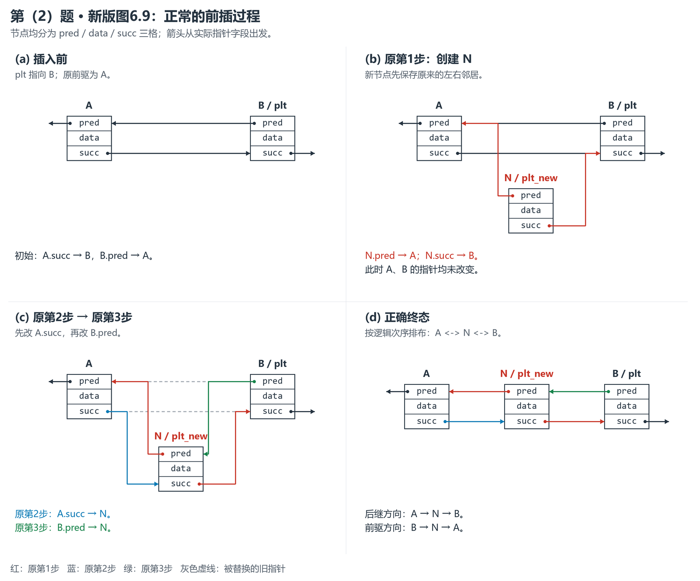
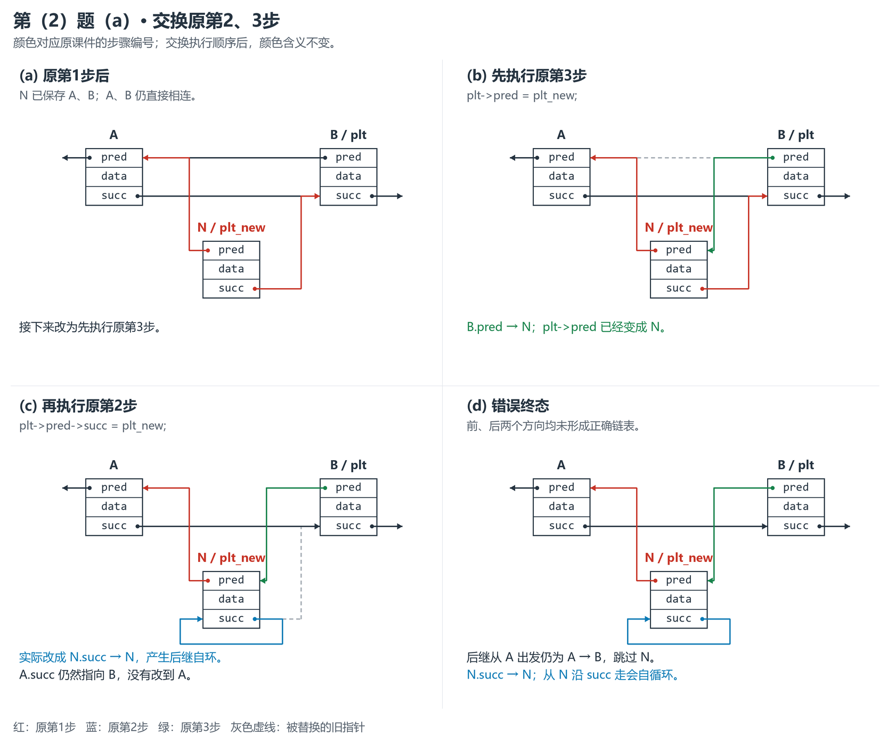
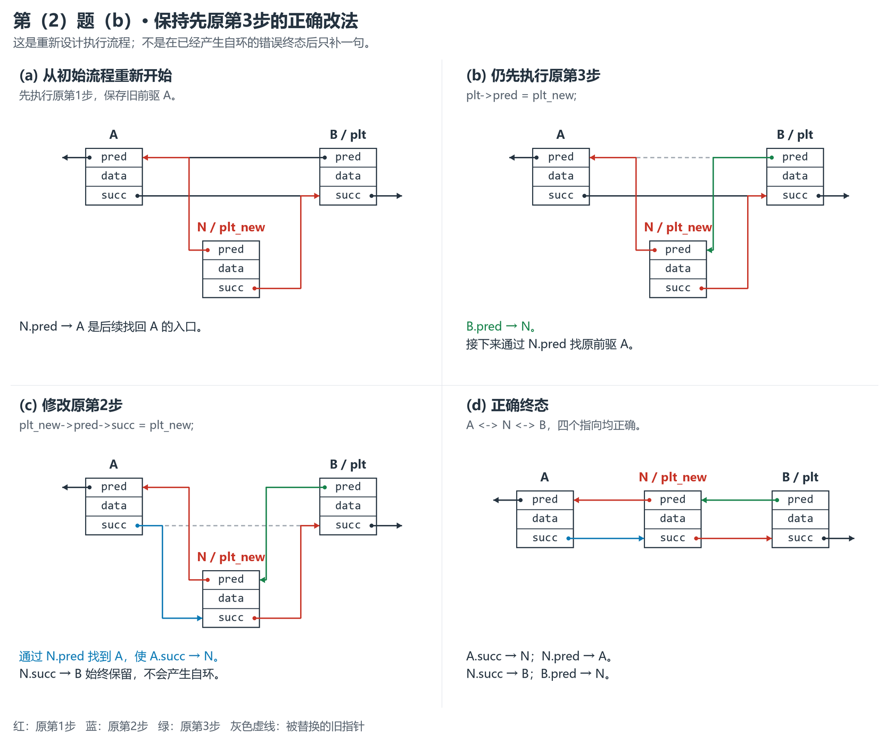
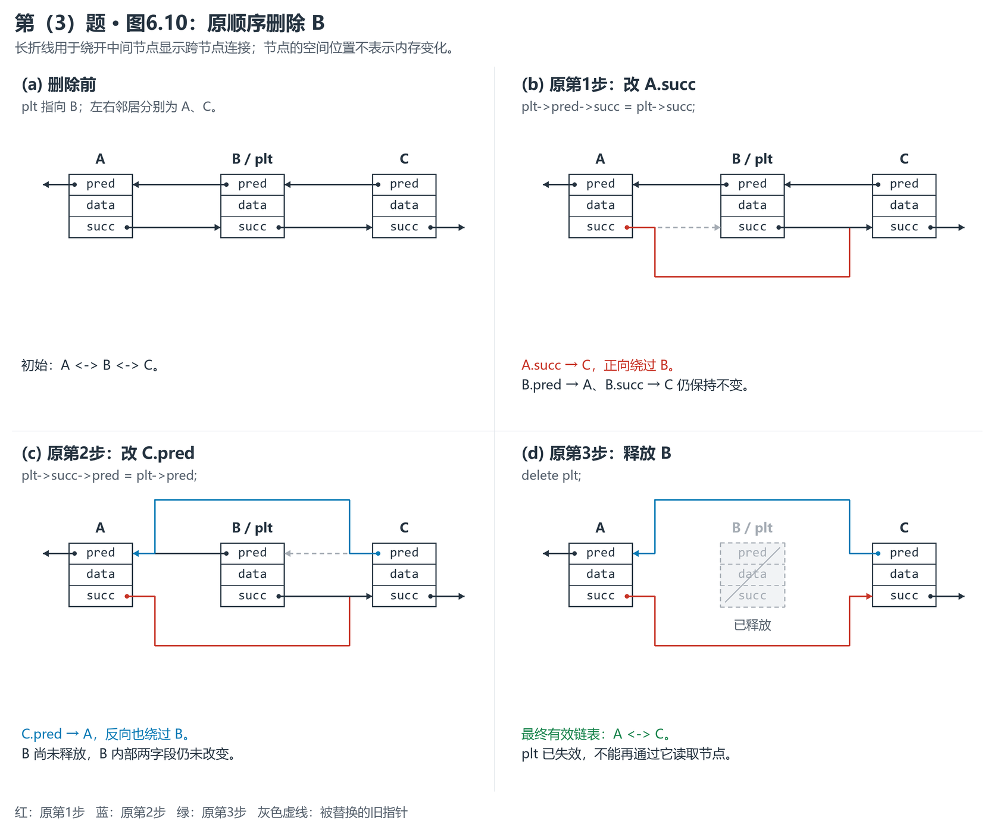
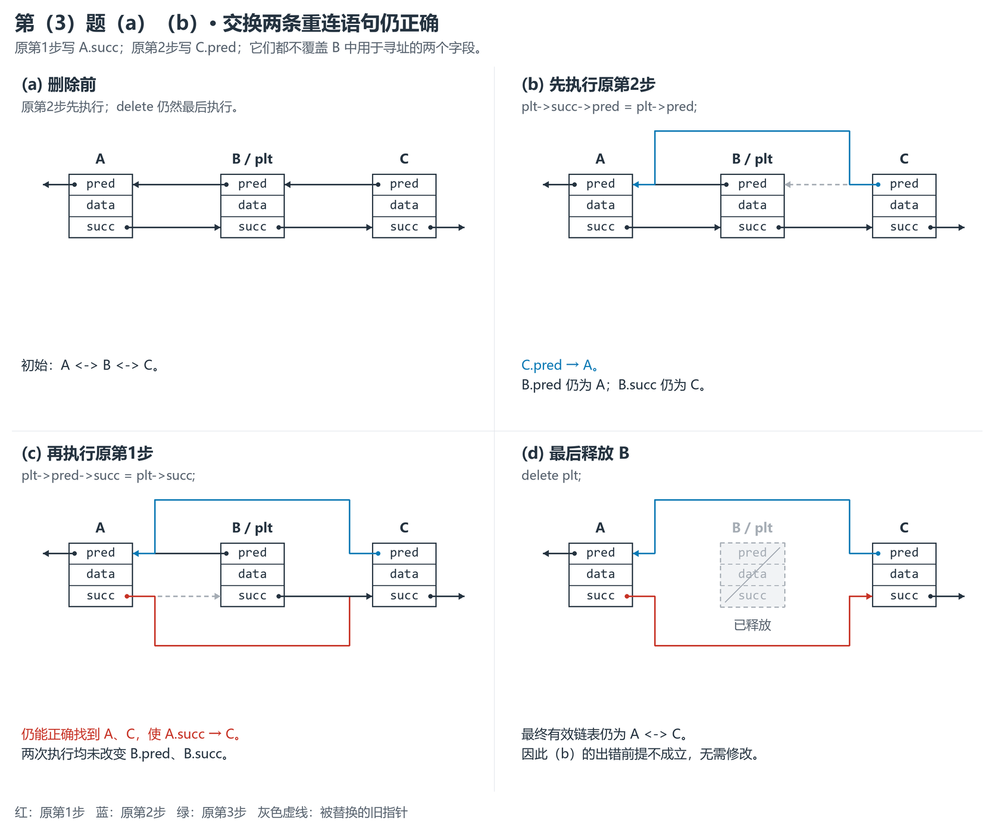

# 习题 6.1：第（2）、（3）题详解与示意图

依据：2026-10-21 更新后的《数据结构课件.pdf》，PDF 第 159 页图 6.9、第 160 页图 6.10。本文按**新版的图号、操作名称、原步骤编号**重新推演。

**先记结论：第（2）题是前插，交换后会出现新节点的后继自环；第（3）题是删除，前两步交换后仍能正确完成。**

| 小题 | 题目指定交换的步骤 | （a）交换后的结果 | （b）应如何处理 |
| --- | --- | --- | --- |
| （2）图 6.9 前插 | 原第 2、3 步 | `N.succ → N`；`A.succ` 仍指向 B，插入失败 | 仍先做原第 3 步，把原第 2 步改成“令 N 的前驱 A 的后继指向 N” |
| （3）图 6.10 删除 | 原第 1、2 步 | 两条重连语句均能正确执行；最后释放 B 后，得到 `A ⇄ C` | 出错前提不成立，原第 1 步无需修改 |

> 新旧版区别：新版图 6.8 是后插，图 6.9 是前插，和题目截图一致。此前按旧版图 6.9“后插”推导的第（2）题不能直接套用；本题应是 **succ 自环**。

## 阅读方法：节点、字段、执行顺序

`plt` 一直指向给定节点 B；`plt_new` 指向新节点 N。A 是 B 原来的前驱；第（3）题中的 C 是 B 原来的后继。字母 A、B、C、N 是为讲解补充的节点名称，不是新建的程序变量。

图中每个节点和课件一样，分成三格：上格 `pred`（前驱指针），中格 `data`（数据），下格 `succ`（后继指针）。箭头从相应字段出发。

| 图中标记 | 含义 |
| --- | --- |
| 红色实线 | 原第 1 步设置的指针 |
| 蓝色实线 | 原第 2 步设置的指针 |
| 绿色实线 | 原第 3 步设置的指针 |
| 灰色虚线 | 被替换的旧指针，已经不再有效 |
| 灰色虚线框、划线节点 | 已释放的节点，不可再访问 |

**即使交换执行顺序，颜色仍按“原步骤编号”标记。** 新节点先画在下方，最后排到左右邻居之间，只是为了看清连线，不表示节点在内存中搬家。

### 考试手写怎么表达

| 理解时的写法 | 课件 C/C++ 写法 | 卷面文字写法 |
| --- | --- | --- |
| `plt.pred` | `plt->pred` | B 的前驱指针；通过它找到 B 的前驱节点 |
| `plt.pred.succ` | `plt->pred->succ` | B 当前前驱节点的后继指针 |
| `plt_new.pred.succ` | `plt_new->pred->succ` | N 当前前驱节点的后继指针 |

`->` 是访问字段的符号，`→` 是示意图中的指向箭头，`=` 是赋值。手写 `plt->pred->succ = plt_new`，就是“将 B 当前前驱节点的后继指针改为指向 N”。

**“当前前驱”会随前面的赋值改变。** 不能把 `plt->pred->succ` 永远当作 A 的 `succ`。题目不要求写程序，下面的少量语句仅用于准确对照课件；作答可以用节点图加文字说明。

## 第（2）题：图 6.9 前插，交换原第 2、3 步

### 1. 正常操作想得到什么

初始局部链表为 `A ⇄ B`，在 B 前插入 N，目标是 `A ⇄ N ⇄ B`。

新版课件的三个步骤为：

| 原步骤 | 课件关键操作 | 对节点的实际影响 |
| --- | --- | --- |
| 第 1 步 | `new ListNode(plt->pred, plt, val)` | 创建 N，令 `N.pred → A`、`N.succ → B` |
| 第 2 步 | `plt->pred->succ = plt_new` | 此时 `plt->pred` 是 A，因此令 `A.succ → N` |
| 第 3 步 | `plt->pred = plt_new` | 令 `B.pred → N` |

正常执行完，四个关键指针是：

```text
A.succ → N       N.pred → A
N.succ → B       B.pred → N
```



### 2. （a）交换后，逐步发生什么

交换的是原第 2、3 步，所以新顺序为：**原第 1 步 → 原第 3 步 → 原第 2 步**。

先执行原第 1 步。N 记住 A、B；A、B 的原指针还没变：

```text
A.succ → B       B.pred → A
N.pred → A       N.succ → B
```

再执行原第 3 步：`plt->pred = plt_new`，即 `B.pred → N`。

此时最关键的变化是：**`plt->pred` 已经指向 N，不再指向 A。**

最后照搬原第 2 步：`plt->pred->succ = plt_new`。从 B 出发，先沿 `pred` 找到 N，再修改 N 的 `succ`，所以实际执行的是：

```text
N.succ → N
```

原本的 `N.succ → B` 被覆盖了，形成**后继自环**。而 A 的 `succ` 从未被修改，仍指向 B。

| 指针字段 | 原第 1 步后 | 再做原第 3 步后 | 最后做原第 2 步后 |
| --- | --- | --- | --- |
| `A.succ` | B | B | B（应改为 N，却未改） |
| `B.pred` | A | N | N |
| `N.pred` | A | A | A |
| `N.succ` | B | B | **N（错误）** |



**怎样检查错误：** 从 A 沿 `succ` 仍直接走到 B，跳过 N；从 N 沿 `succ` 会不断回到 N。虽然从 B 沿 `pred` 能走到 N，再走到 A，但正反向连接已经不对应，不能写成正确的 `A ⇄ N ⇄ B`。

### 3. （b）坚持先做原第 3 步，怎么改原第 2 步

这里“原先的第二个步骤”指题目所选两步中后面的那一步：本小题是原第 3 步。我们仍让它先执行，然后修改原第 2 步。

所需动作始终是：**把 A 的 `succ` 改成指向 N。** 只是此时不能再通过 `B.pred` 直接找 A，因为它已经被改成 N。

好在原第 1 步已经保存了 `N.pred → A`，可以改从 N 找到 A：

```text
plt_new 所指的 N ──pred──→ A
将 A.succ 改为指向 N。
```

因此，原第 2 步改为：

```cpp
plt_new->pred->succ = plt_new;
```

修改后的执行过程是：

1. 原第 1 步：创建 N，令 `N.pred → A`、`N.succ → B`。
2. 先做原第 3 步：令 `B.pred → N`。
3. 做修改后的原第 2 步：沿 `N.pred` 找 A，令 `A.succ → N`。

最终四个指针都符合 `A ⇄ N ⇄ B`。



> 这里是在重新设计正确流程：从原第 1 步开始，先做原第 3 步，再做修改后的原第 2 步。若已经执行到（a）的错误终态，仅补上 `A.succ → N` 还不够，因为还需要恢复 `N.succ → B`。

### 4. 可以手写在答卷上的答案

**（a）** 设 `plt` 指向 B，其原前驱为 A，新节点为 N。原第 1 步后，`N.pred → A`、`N.succ → B`。先执行原第 3 步后，`B.pred → N`，因此再执行原第 2 步时，`plt->pred->succ` 指的是 N 的 `succ`。结果 `N.succ → N`，形成后继自环；`A.succ` 仍指向 B，未能正确插入 N。

**（b）** 仍先执行原第 3 步时，可通过新节点保存的 `N.pred` 找到原前驱 A，再令 `A.succ → N`。即将原第 2 步改为 `plt_new->pred->succ = plt_new`，最终得到 `A ⇄ N ⇄ B`。

配图时至少画出错误终态的四个指向，以及修改后的正确终态；标出 `N.succ → N` 的自环。

## 第（3）题：图 6.10 删除，交换原第 1、2 步

### 1. 正常操作想得到什么

设 `plt` 指向待删除节点 B，初始局部链表为 `A ⇄ B ⇄ C`，目标是让 A、C 直接相连，再释放 B。

| 原步骤 | 课件关键操作 | 对节点的实际影响 |
| --- | --- | --- |
| 第 1 步 | `plt->pred->succ = plt->succ` | 令 `A.succ → C`，正向绕过 B |
| 第 2 步 | `plt->succ->pred = plt->pred` | 令 `C.pred → A`，反向绕过 B |
| 第 3 步 | `delete plt` | 释放 B |

课件还会先保存 B 的数据、最后减少链表长度并返回数据；本题只讨论图中标注的三步，其他操作不变。



### 2. （a）交换后，逐步发生什么

新顺序为：**原第 2 步 → 原第 1 步 → 原第 3 步**。

首先做原第 2 步：`plt->succ->pred = plt->pred`。

- `plt` 是指向 B 的指针。
- 沿 `B.succ` 找到 C，将 `C.pred` 改为指向 A。
- 这一步改的是 **C 的 `pred`**，B 内部的 `pred`、`succ` 都没变。

此时局部指向为：

```text
A.succ → B       B.pred → A
B.succ → C       C.pred → A
```

接着做原第 1 步：`plt->pred->succ = plt->succ`。

- B 尚未释放，`B.pred` 仍指向 A，`B.succ` 仍指向 C。
- 因而仍能正确找到 A、C，令 `A.succ → C`。

现在 A、C 已双向直连；最后执行 `delete plt` 释放 B，最终有效链表为 `A ⇄ C`。



### 3. 为什么这两步可以交换

不要只看两条语句都出现 `pred`、`succ`，要看**究竟读写了哪个节点的哪个字段**。

| 原步骤 | 用来找邻居的字段 | 实际写入的字段 | 是否覆盖另一条语句寻找邻居所需的 B 的字段 |
| --- | --- | --- | --- |
| 第 1 步 | `B.pred`、`B.succ` | `A.succ` | 否 |
| 第 2 步 | `B.succ`、`B.pred` | `C.pred` | 否 |

两步都通过 B 原有的前驱、后继指针找到邻居；它们只改邻居的字段，没有改动 B 内部用于寻找邻居的两个字段。因此交换不会使另一条语句找错目标。

中间只执行一条重连语句时，正反向指向会暂时不一致；判断算法是否出错，要继续检查后一条语句是否仍能正确执行，以及全部完成后是否得到目标结构。

**释放必须放在两条重连语句之后。** “前两步可交换”不表示可以提前执行 `delete plt`；释放 B 后，再通过 `plt` 读取 B 的字段就不合法了。

### 4. （b）需要修改原第 1 步吗

**不需要。** 问题（b）以“如果交换后出错”为前提，但本小题交换后仍然正确，前提不成立。

保持原第 2 步先执行时，原第 1 步 `plt->pred->succ = plt->succ` 仍可照常使用；完成两条重连语句后，再释放 B 即可。

### 5. 可以手写在答卷上的答案

**（a）** 设 `plt` 指向待删除节点 B，前驱为 A、后继为 C。先执行原第 2 步，使 `C.pred → A`。此时 B 的 `pred`、`succ` 均未改变，因此再执行原第 1 步仍能使 `A.succ → C`。最后释放 B，得到 `A ⇄ C`，删除仍正确。

**（b）** 交换后不出错，因此原第 1 步无需修改。两条重连语句分别修改 `A.succ`、`C.pred`，均未覆盖 B 的前驱、后继指针，故可交换；释放 B 仍应最后执行。

配图时画出“先 `C.pred → A`、再 `A.succ → C`、最后释放 B”的过程。B 尚未释放时，保留图中 `B.pred → A`、`B.succ → C`，这正是解释可交换的关键。

## 最后检查：两题为什么结论不同

| 检查问题 | 第（2）题前插 | 第（3）题删除 |
| --- | --- | --- |
| 提前执行的语句改了什么 | 原第 3 步改变 `B.pred` | 原第 2 步改变 `C.pred` |
| 后面那条语句要借助什么寻址 | 需要借助 `B.pred` 找 A | 需要借助 `B.pred`、`B.succ` 找 A、C |
| 寻址入口是否被覆盖 | 是，`B.pred` 已改为 N | 否，B 内部两个字段都没变 |
| 结论 | 会找错修改对象，要改用 `N.pred` 找 A | 可以交换，无需修改 |

手算这类题时，每执行一步，就在图上改对应字段的箭头；下一步从当前图重新寻找目标。不要一直沿用初始图的邻居关系。

---

核对记录：本次源 PDF 共 368 页，SHA-256 为 `A3BCD09884E4DC6ACFFBE655E2C15A1CF86C926E425120126E3D0BA0EF11C65E`。本次重新核对了图 6.8—6.10 的原页；以上结论为依据课件代码的逐步推导，示意图为重绘。
