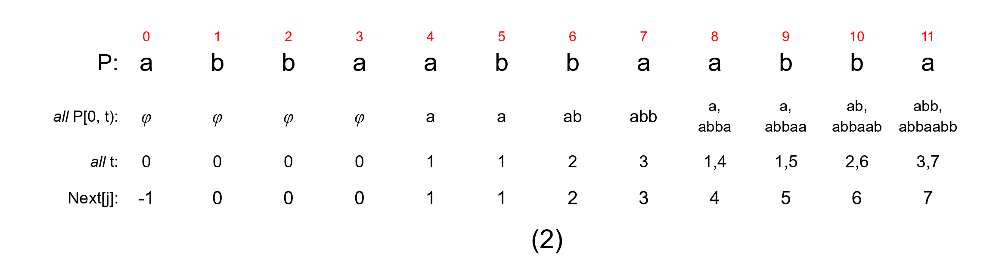

# 习题 7.1 第（2）题：普通 Next 表的直接构造

课件：ds-note1028，习题 7.1 第（2）题（PDF p.194）；画法参照 Figure 7.8（p.184）。模式串 P=abbaabbaabba，共 12 个字符，下标从 0 开始。

按普通 Next 定义：Next[0]=−1。j≥1 时，只研究 P[0,j)，不含当前字符 P[j]；寻找满足 P[0,t)=P[j−t,j)、0≤t<j 的最大 t。

## 每列的构造依据

| j | P[j] | 只研究 P[0,j) | 所有非空相等真前后缀 | 对应正长度 t | Next[j] |
| --- | --- | --- | --- | --- | --- |
| 0 | a | 空串 | φ，图示占位 | 0，图示占位 | −1，单独规定 |
| 1 | b | a | φ | 0 | 0 |
| 2 | b | ab | φ | 0 | 0 |
| 3 | a | abb | φ | 0 | 0 |
| 4 | a | abba | a | 1 | 1 |
| 5 | b | abbaa | a | 1 | 1 |
| 6 | b | abbaab | ab | 2 | 2 |
| 7 | a | abbaabb | abb | 3 | 3 |
| 8 | a | abbaabba | a、abba | 1、4 | 4 |
| 9 | b | abbaabbaa | a、abbaa | 1、5 | 5 |
| 10 | b | abbaabbaab | ab、abbaab | 2、6 | 6 |
| 11 | a | abbaabbaabb | abb、abbaabb | 3、7 | 7 |

图中有多个相等段时，`all P[0,t)` 行将它们分行列出，`all t` 行列出全部对应正长度，Next[j] 取其中最大值；不存在非空相等段时以 φ 表示、长度记 0。第 0 列仍按课件单独规定 Next[0]=−1。

**结果：Next=(−1,0,0,0,1,1,2,3,4,5,6,7)。**

## 两个关键位置

求 Next[8] 时只看 abbaabba。首尾各有 a，也各有 abba，所以 t=1、4；必须取最大值 4，不能只写最短的 a 对应的 1。

求 Next[11] 时只看 abbaabbaabb，不纳入最后的 a。最长相等真前后缀是 abbaabb，长度 7，因此填 7；整串的重复段 abbaabba 长度为 8，不能拿来填这一格。

## 当场说明这张图

老师，这张图按课件 Figure 7.8，用直接构造法求模式串 abbaabbaabba 的普通 Next 表。下标从 0 开始，先单独规定 Next[0]=−1。对每个 j≥1，只看 P[0,j)，找出所有头尾相等的真子串，在 all P[0,t) 行列出内容，在 all t 行列出对应长度，再取最大长度填入 Next[j]。j=1、2、3 时没有非空相等段，因此填 0；j=4、5 时最长相等段为 a，填 1；之后依次得到 2、3、4、5、6、7。特别是 j=8 时同时存在 a 和 abba，对应 1 和 4，所以取 4。最终 Next 表为 −1、0、0、0、1、1、2、3、4、5、6、7。

本次为完整解答示范，尚未收到学生独立作答，掌握情况未评估。
