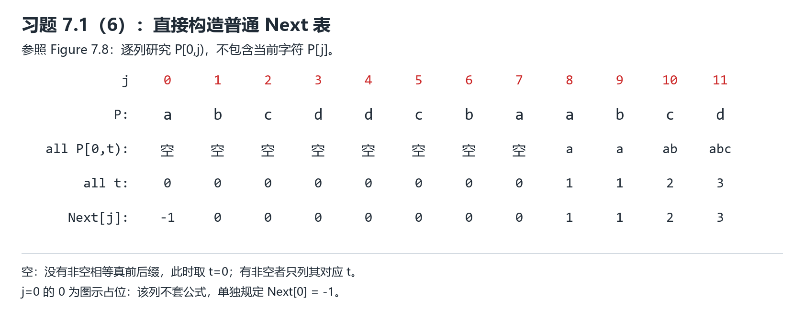

# 7.1 普通 Next 表的直接构造法：第（6）题示范

依据 2026-10-28 新课件：PDF 第 182—184 页，尤其第 183 页“Next 表的直接构造方法”和第 184 页 Figure 7.8；题目在第 194 页。这里只做普通 Next，不做习题 7.2 的更新版 Next，也不写代码。

## 先理解到底在找什么

KMP 匹配到模式串 P 的第 j 个字符时，如果发生失配，前面 j 个字符已经匹配。Next[j] 告诉我们：可以保留多少个已匹配字符，让模式串的哪个下标接着比较。

因此，构造 Next[j] 只需要研究模式串自身，**无需文本串 T**。

本课下标从 0 开始，区间左闭右开。`P[0,j)` 是下标 0 到 j−1 的字符，**不包含 P[j]**。

对于 j≥1：找 `P[0,j)` 的最长相等真前缀、真后缀，长度就是 Next[j]。前缀从最左端开始，后缀在最右端结束；“真”表示不能拿整段自身比较。二者必须逐字相同，不能倒着比。

课件写作：在 `0≤t<j` 中，找使 `P[0,t)=P[j−t,j)` 成立的最大 t。找不到非空相等段，就取 0；`Next[0]=−1` 单独规定，不套这个最大值公式。

### 一个小例子

如果眼下只研究 `abab`：

- 长度 3：前缀 `aba`，后缀 `bab`，不等。
- 长度 2：前缀 `ab`，后缀 `ab`，相等，已经是最长。

所以当 `P[0,j)=abab` 时，Next[j]=2。不是填字符串 `ab`，而是填它的长度 2；也不是填最后一个字符的下标 1。

## 直接构造法的手算步骤

1. 在模式串上方标下标 0、1、2……，先填 Next[0]=−1。
2. 对每一列 j，先截取当前字符左边的 `P[0,j)`。
3. 比较这段的真前缀与真后缀，可从长度 j−1 往下尝试，找到第一个相等长度就停。
4. 按 Figure 7.8 列出相等段、对应长度 t，再取最大长度填 Next[j]。全部不等则填 0。

这里说“从长往短试”是便于手算的次序，不是课件后面的迭代构造法。本次不使用递推或更新版规则。

## 第（6）题：P = abcddcbaabcd

共 12 个字符，下标是 0—11：

| j | 0 | 1 | 2 | 3 | 4 | 5 | 6 | 7 | 8 | 9 | 10 | 11 |
| --- | --- | --- | --- | --- | --- | --- | --- | --- | --- | --- | --- | --- |
| P[j] | a | b | c | d | d | c | b | a | a | b | c | d |

### 先看课件要求的流程示意图

Figure 7.8 的“流程图”是**按下标逐列列出的构造过程表**，不用画程序里的开始、判断菱形、结束框。上方写模式串，下面依次写所有相等首尾段、它们的长度 t、最终 Next[j]。

图中 `all P[0,t)` 是所有非空相等真前后缀的内容；不存在时标“空”。`all t` 有非空者时列出对应正长度，否则记 0。第 0 列按课件图示占位，Next[0] 仍单独设 −1。

### 再逐列解释为什么

| j | 只研究 P[0,j) | 最长相等真前缀、真后缀 | Next[j] |
| --- | --- | --- | --- |
| 0 | 空串 | 单独规定 | −1 |
| 1 | a | 没有非空真前后缀 | 0 |
| 2 | ab | 无 | 0 |
| 3 | abc | 无 | 0 |
| 4 | abcd | 无 | 0 |
| 5 | abcdd | 无 | 0 |
| 6 | abcddc | 无 | 0 |
| 7 | abcddcb | 无 | 0 |
| 8 | abcddcba | a = a，长度 1 | 1 |
| 9 | abcddcbaa | a = a，长度 1 | 1 |
| 10 | abcddcbaab | ab = ab，长度 2 | 2 |
| 11 | abcddcbaabc | abc = abc，长度 3 | 3 |

**j=1—7 为什么都是 0？** 非空前缀必须从首字符 a 开始。上述各段除了开头，没有第二个 a，因此没有非空真后缀能与前缀相等。注意 j=7 只看 `abcddcb`，还没有纳入 P[7] 的 a。

**j=8：** 截取 `abcddcba`。真后缀若要匹配前缀，必须从后面的 a 开始；这里仅最后一个字符 a 能满足，得到长度 1。

**j=9：** 截取 `abcddcbaa`。后面的 a 有两个起点：较长候选 `aa` 与前缀 `ab` 不等，较短候选 `a` 相等，所以仍填 1。不能因为多纳入一个 a 就直接填 2。

**j=10：** 截取 `abcddcbaab`。较长候选 `aab` 与前缀 `abc` 不等，候选 `ab` 相等，填 2。

**j=11：** 截取 `abcddcbaabc`。较长候选 `aabc` 与前缀 `abcd` 不等，候选 `abc` 相等，填 3。

这里检查的候选都是从后面的 a 开始的真后缀；其他位置以 b、c、d 开始，第一字符就与前缀的 a 不等。因此没有漏掉更长候选。

### 为什么看起来对称，却不是很长的重复段

`abcddcba` 是对称结构，但前缀 `abcd` 和后缀 `dcba` 顺序不同，并不相等。Next 要求的是**同方向逐字相等**，不是镜面对称。

### 最后一格为什么不是 4

整串 `abcddcbaabcd` 的确以 `abcd` 开头、结尾，但本题最后一格是 Next[11]，只研究 `P[0,11)=abcddcbaabc`，**最后一个 d 尚未纳入**，所以填 3。

如果另行定义匹配完整模式后的扩展项 Next[12]，才会得到 4。本题按课件 Figure 7.8 只填 j=0—11 的 12 项，不增加第 13 项。

## 可直接参考的卷面文字

采用课件 0 起始下标与普通 Next 定义，先置 Next[0]=−1。对每个 j≥1，在 P[0,j) 中寻找最长相等真前缀、真后缀，其长度即 Next[j]。j=1—7 时无非空相等段；j=8、9 时最长相等段均为 a；j=10 时为 ab；j=11 时为 abc。故：

**Next = (−1, 0, 0, 0, 0, 0, 0, 0, 1, 1, 2, 3)。**

配上第一张 Figure 7.8 式构造表，即展示了各列的构造依据和结果。第二张图用于帮助理解，手写时可按需要补画关键列，不必抄全部讲解。

## 你可以接着尝试

不看表，解释两个问题：① Next[7] 为什么是 0，而 Next[8] 是 1？② Next[9] 为什么仍是 1？

本次已给完整示范，尚未收到你的独立作答，掌握情况未评估。
