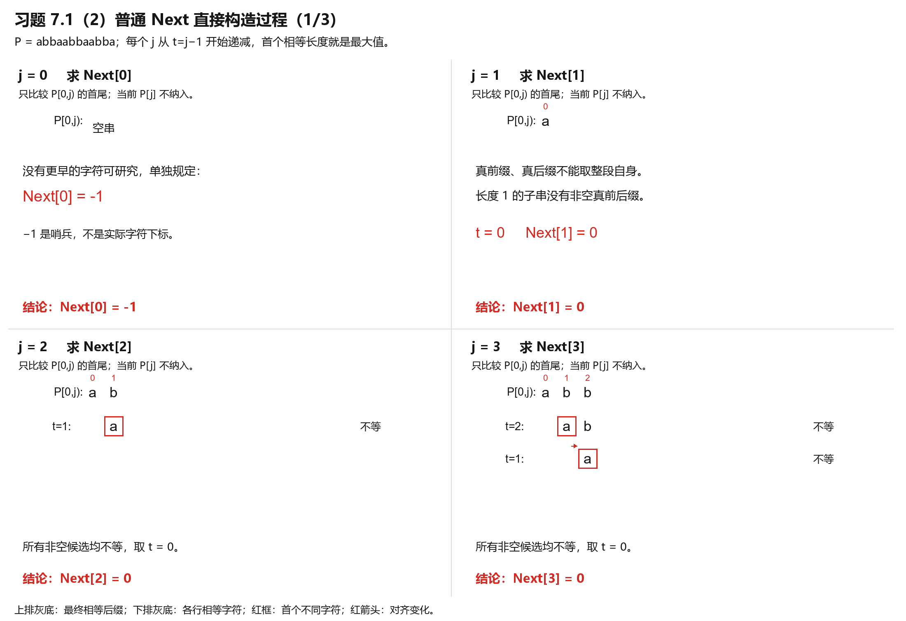
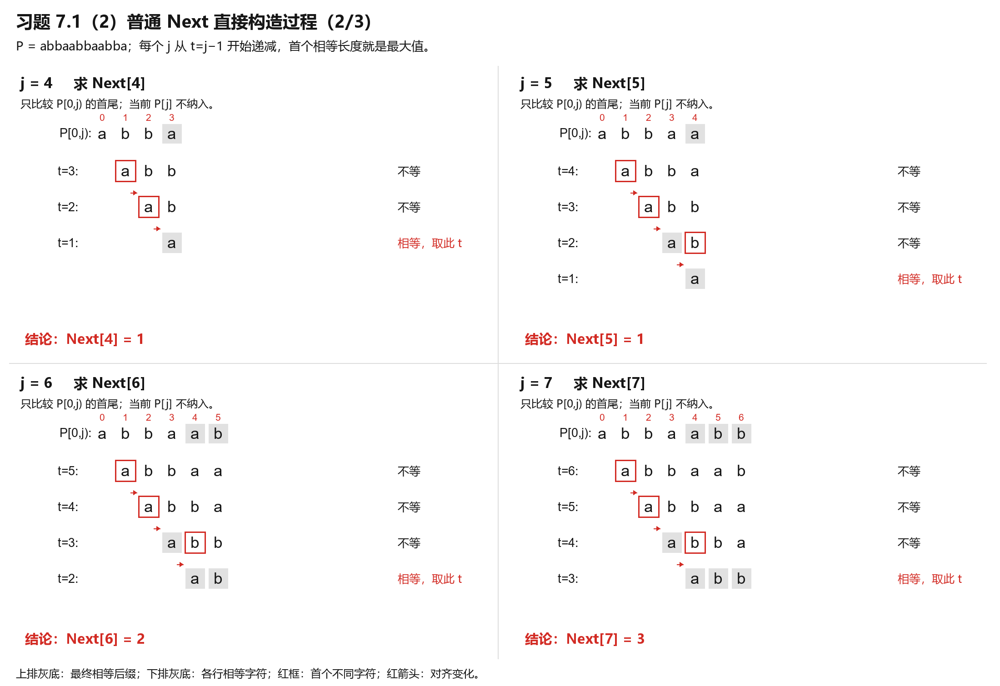
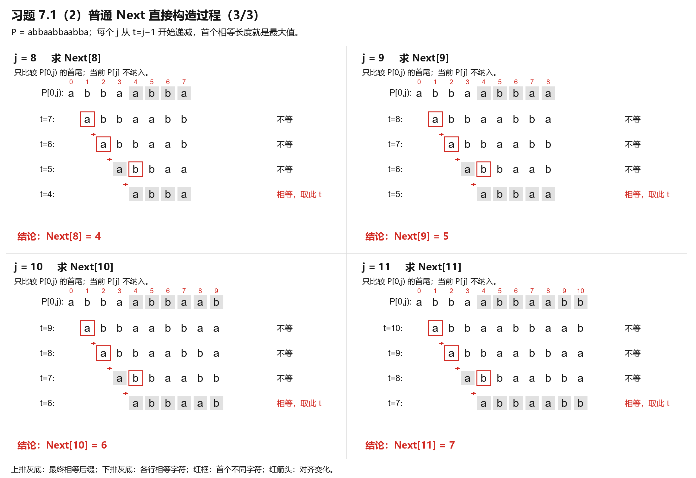

# 习题 7.1（2）：逐行对齐的 Next 构造过程

按用户要求暂停逐章教学。本题仍指课件习题 7.1 第（2）题 P=abbaabbaabba，不是此前新出的蛮力练习 T=aaaab、P=aab。

题目要求直接构造普通 Next 表，本笔记借用参考照片“逐行对齐、下标标注、比较方框”的排版，展示模式串自身的前后缀比较；没有另设文本串 T，也不将构表误作实际的 T/P 匹配过程。

约定：0 起始下标，Next[0]=−1；对于每个 j≥1，只看 P[0,j)，当前 P[j] 不纳入。将候选真前缀 P[0,t) 对齐真后缀 P[j−t,j)，从 t=j−1 开始递减；第一个相等的 t 即为最大值。不使用 Next 迭代递推替代题目要求的直接法。

## j=0—3

## j=4—7

## j=8—11

上排灰底突出最终找到的相等后缀；下排灰底表示各行对齐中确认相等的字符；红框表示首个不同字符；红箭头表示缩短 t 后向右对齐。灰底不是把这次构表中的字符比较“省略”，也不是普通 KMP 匹配图中“相对蛮力跳过的子串”。

因为直接按候选长度从大到小比较，找到第一个相等长度后即可确定最大值；较短但也相等的候选无需继续画。若需要 Figure 7.8 中的 all t 行，仍应列全所有相等候选，见[已有构造表与详解](7.1-直接构造Next表-第2题.md)。

最终：**Next=(−1,0,0,0,1,1,2,3,4,5,6,7)**。

本次是完整答案展示，不记录为学生独立作答；教学暂停，等待用户后续要求。
