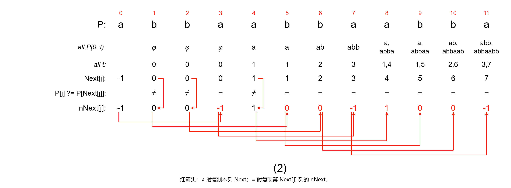
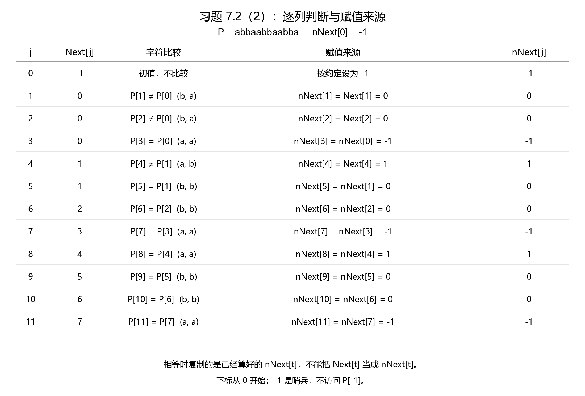

# 习题 7.2（2）：更新版 nNext 表的直接构造

日期：2026-11-04。依据老师最新讲义 ds-note1104（376 页）§7.6 第 6 小节，PDF 第 194 页方法、195 页 Figure 7.19；题目在第 200 页。这里的 7.2 是习题编号，不是讲义 §7.2。下标从 0 开始，区间左闭右开。

## 完整题目

使用直接构造法写出模式串 **P = abbaabbaabba** 对应的更新版 Next 表，并画出计算流程示意图，格式参照讲义 Figure 7.19。无需写代码。

## 可照着手画的流程图



前四行沿用上次普通 Next 的直接构造；新增比较行与 nNext 行。红色折线箭头表示赋值来源，交叉处不表示连接。相等时按箭头从左侧已经求出的 nNext 值，复制到当前列。

## 方法：先构造普通 Next，再逐列构造 nNext

1. 对每个 j，研究 **P[0,j)**，不含当前字符 P[j]。列出相等真前后缀 P[0,t)=P[j−t,j)，取最大长度得到 Next[j]。Next[0]=−1 单独设置。
2. 单独设置 nNext[0]=−1；从 j=1 开始比较 P[j] 与 P[Next[j]]。
3. 若不相等，nNext[j]=Next[j]，箭头从本列 Next 值指向本列 nNext 值。
4. 若相等，nNext[j]=nNext[Next[j]]，箭头从第 Next[j] 列的 nNext 值指向本列 nNext 值。因为 Next[j]<j，该值已经算好。

这里遵循新版课件所称的“直接构造法”：先有普通 Next，再按字符比较把它更新；不是直接使用新版第 7 小节的迭代程序。−1 是哨兵，不是可访问的字符下标，不比较 P[−1]。

为什么多比较这两个字符？若文本当前字符已经与 P[j] 不同，而 P[Next[j]]=P[j]，那么退到该位置仍一定失配，所以继续采用那个位置已经算好的 nNext 跳转结果。

图中 all P[0,t) 表示普通 Next 构造中的所有非空相等首尾段，all t 表示其长度。沿课件记法，有正长度时省略默认的 0；没有非空相等段时写 φ 和 0。j=0 两行留空，直接使用哨兵初值。对于 j≥1，空串长度 0 在普通 Next 定义里始终合法；省略它不影响取最大值。这些行仍是**普通 Next 的候选**，不应先按更新版条件删掉候选再填写这一部分。

## 逐列过程



| j | P[j] | 普通 Next[j] | 比较 | nNext 的赋值来源 | 结果 |
| --- | --- | --- | --- | --- | --- |
| 0 | a | −1 | 初值，不比较 | 单独设置 | −1 |
| 1 | b | 0 | b≠a | Next[1] | 0 |
| 2 | b | 0 | b≠a | Next[2] | 0 |
| 3 | a | 0 | a=a | nNext[0] | −1 |
| 4 | a | 1 | a≠b | Next[4] | 1 |
| 5 | b | 1 | b=b | nNext[1] | 0 |
| 6 | b | 2 | b=b | nNext[2] | 0 |
| 7 | a | 3 | a=a | nNext[3] | −1 |
| 8 | a | 4 | a=a | nNext[4] | 1 |
| 9 | b | 5 | b=b | nNext[5] | 0 |
| 10 | b | 6 | b=b | nNext[6] | 0 |
| 11 | a | 7 | a=a | nNext[7] | −1 |

特别注意 j=7：Next[7]=3，P[7]=P[3]=a，因此复制 **nNext[3]=−1**，不能复制 Next[3]=0。j=8 则复制 nNext[4]=1，也不是直接把 Next[8]=4 写下来。

## 最终答案

```text
j:       0  1  2  3  4  5  6  7  8  9 10 11
P:       a  b  b  a  a  b  b  a  a  b  b  a
Next:   -1  0  0  0  1  1  2  3  4  5  6  7
nNext:  -1  0  0 -1  1  0  0 -1  1  0  0 -1
```

## 给老师说明这张图

我先对每一个下标 j，找出 P[0,j) 内相等的真前后缀，并取其最大长度构造初版 Next 表。随后设置 nNext[0]=−1，从左向右比较 P[j] 与 P[Next[j]]：若不相等，就令 nNext[j]=Next[j]；若相等，则令 nNext[j]=nNext[Next[j]]，以跳过必定再次失配的位置。图中的红色箭头表示数值的赋值来源。例如 j=7 时，Next[7]=3，且 P[7]=P[3]，因此采用已经求出的 nNext[3]=−1。

本题只需交示意图与文字说明，无需提交程序。生成配图时另用独立候选枚举交叉核对了结果，不把验算程序写入作业答案。

- [最新课件](../../notes/ds-note1104.pdf#page=194)
- [上次普通 Next 第（2）题](7.1-直接构造Next表-第2题.md)（保留原版页码，最新对应图号已改为 Figure 7.12）
- [本次学习记录](../../chapters/07-string/sessions/2026-11-04-nnext-direct-ex2.md)
