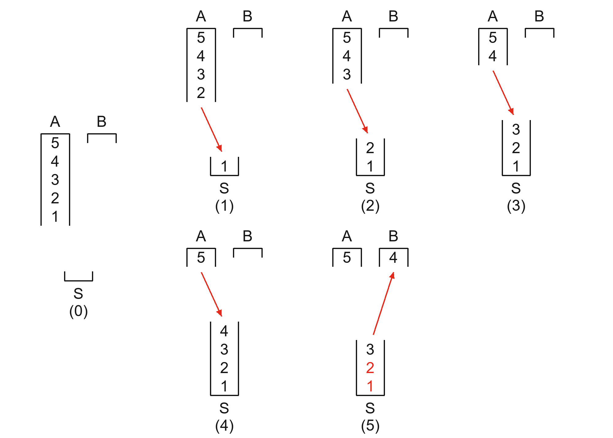

# 习题 8.3（1）栈混洗操作图

题目采用 2026-11-11 对话截图第（1）问。绘图参照 [11 月 4 日版课件 Figure 8.4（PDF 第 209 页）](../../notes/ds-note1104.pdf#page=209)。

## 题目与约定

初始栈 A 从栈底到栈顶依次为 5、4、3、2、1，B 和 S 为空。每步可把 A 的栈顶移到 S，或把 S 的栈顶移到 B。画出操作过程，求 B 从栈底到栈顶形如 `[2, ?, ?, ?, 4⟩` 的全部栈混洗序列。

题式的 `[` 表示栈底，`⟩` 表示栈顶。A、B 开口朝下，S 开口朝上。题目要求 4 第一个进 B，2 最后一个进 B。

## 操作过程

（0）为初始状态。红箭头表示得到当前状态的操作。（1）至（4）依次把 1、2、3、4 从 A 移入 S。（5）把 4 从 S 移入 B。前五步由 B 的栈底条件确定。若 4 进 B 前先把 5 压入 S，5 就会挡住 4。

在（5）中，S 从栈顶到栈底依次为 3、2、1。要把 1 移入 B，必须先把压在 1 上面的 2 移入 B，所以 **2 一定比 1 先进入 B**。这与 2 最后进入 B 的要求矛盾。

**第（1）问共有 0 个满足条件的栈混洗序列。** 图画到（5）即可判定无解。

课件第 214 页习题 8.3 的正文写的是栈顶 4、栈底 2。[Figure 8.8（第 215 页）](../../notes/ds-note1104.pdf#page=215)画的是栈顶 2、栈底 4，与本次截图第（1）问一致。题目条件按截图，三栈画法按 Figure 8.4。

[学习记录](../../chapters/08-stack-queue/sessions/2026-11-11-stack-shuffle-ex1.md)
