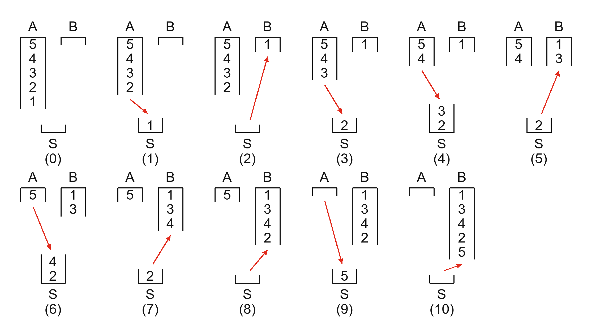
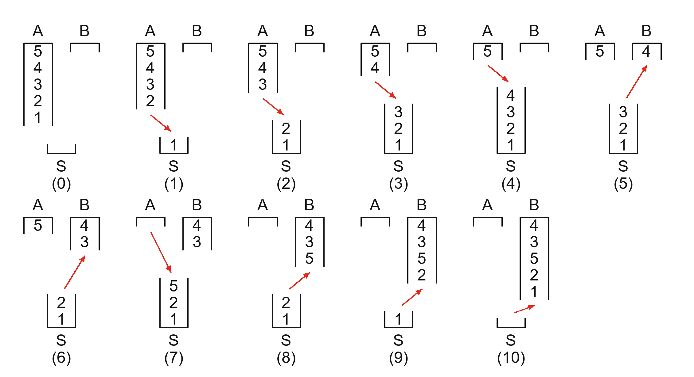

# 习题 8.3（4）栈混洗操作图

题目见 [11 月 12 日版课件第 214 页](../../notes/ds-note1112.pdf#page=214)，图的画法参照 [Figure 8.4（第 209 页）](../../notes/ds-note1112.pdf#page=209)。

## 题目与约定

A 从栈底到栈顶为 `[5, 4, 3, 2, 1⟩`，B 和辅助栈 S 初始为空。每步只移动一个栈顶元素，方向为 A → S 或 S → B。求所有形如 `[?, 3, ?, 2, ?⟩` 的 B，并画出操作过程。

A、B 开口朝下，S 开口朝上。因此 A 依次弹出 1、2、3、4、5。B 按栈底到栈顶书写，所以 3 是第 2 个进入 B 的元素，2 是第 4 个。

## 两条操作流程

（0）为初始状态。红箭头表示得到当前状态的那一步操作。

**流程一得到 `[1, 3, 4, 2, 5⟩`。**

**流程二得到 `[4, 3, 5, 2, 1⟩`。**

## 为什么只有这两种

第 2 项和第 4 项已经指定为 3、2，第 1 项只有 1、4、5 三种可能。

| 第 1 个进入 B 的元素 | 推演 |
| --- | --- |
| 1 | 当 3 第二个进入 B 后，S 中只剩 2，A 还有 4、5。第三个必须是 4 或 5。若选 5，就得先把 4 压进 S，5 弹出后 4 仍挡在 2 上方。故第三个只能是 4，接着送出 2，最后送出 5。 |
| 4 | 先把 1、2、3、4 压入 S，再弹出 4、3。此时 2 压着 1，而 2 留给第四项，故第三项只能是从 A 取出的 5。随后弹出 2、1。 |
| 5 | 要先送出 5，必须先把所有元素压入 S。弹出 5 后，S 的栈顶是 4，第二项只能是 4。 |

[学习记录](../../chapters/08-stack-queue/sessions/2026-11-12-stack-shuffle-ex4.md)
