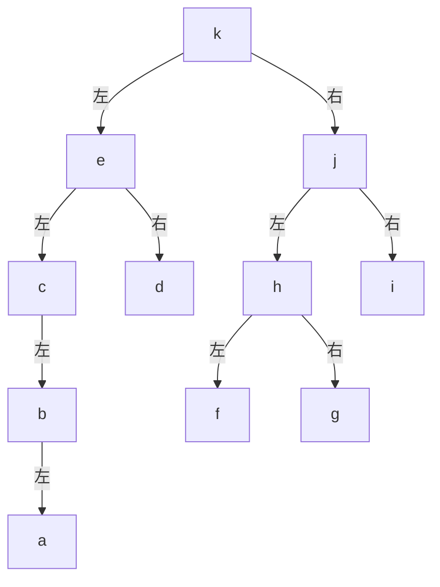
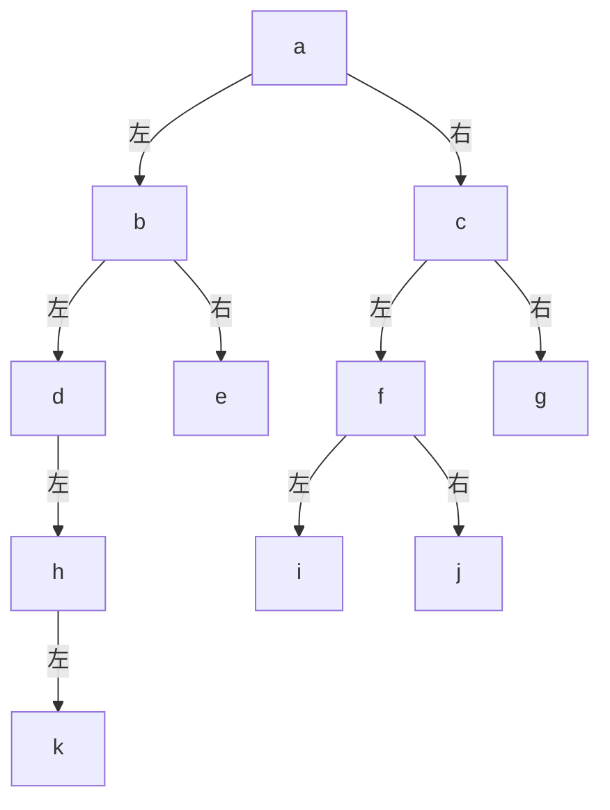

# 13.1 二叉树的构型，第（3）、（4）问

2026-11-18 首次按截图作答。2026-11-19 已核对 [11 月 19 日版习题 13.1（p.264）](../../notes/ds-note1119.pdf#page=264)，题面与截图一致，现有构型与遍历结果仍适用。新版第 13 章对应原第 11 章“二叉树”，此笔记继续存入原二叉树主题目录。详见[版本核对记录](../../chapters/11-binary-tree/sessions/2026-11-19-version-check-13-1.md)。

[两页作答 PDF](../../output/pdf/13.1-二叉树构型-第3、4问.pdf) · [给老师的说明](13.1-第3、4问-给老师的说明.md)

## 完整作答条件

11 个结点，关键码为 a～k。同时要求树高为 4（根深度为 0），根的左右子树高度相差 1，并有一棵子树为满二叉树。第（3）问给定后序遍历为 a b c d e f g h i j k，第（4）问给定层次遍历为同一序列。每问画一棵满足条件的树，并写出其余三种遍历序列。存在多解时任选一棵。

树高按边数计算。遍历约定为先序“根、左、右”，中序“左、根、右”，后序“左、右、根”，层次遍历每层从左到右。满二叉树采用每层结点均满的定义。

## 构造思路

先确定一棵 11 结点的树形，使根的左子树高为 3，右子树高为 2，右子树内部含一棵三结点满二叉树。然后按指定的后序或层次顺序依次填入 a～k。两问使用相同树形、不同标号。每问只需一种构型。

## 第（3）问

- 先序遍历为 `k e c b a d j h f g i`。
- 中序遍历为 `a b c e d k f h g j i`。
- 后序遍历为 `a b c d e f g h i j k`。
- 层次遍历为 `k e j c d h i b f g a`。

最长路径为 k → e → c → b → a，深度从 0 至 4。左右子树高度为 3、2。以 h 为根、孩子为 f 和 g 的三结点子树为满二叉树。

## 第（4）问

- 先序遍历为 `a b d h k e c f i j g`。
- 中序遍历为 `k h d b e a i f j c g`。
- 后序遍历为 `k h d e b i j f g c a`。
- 层次遍历为 `a b c d e f g h i j k`。

最长路径为 a → b → d → h → k，深度从 0 至 4。左右子树高度为 3、2。以 f 为根、孩子为 i 和 j 的三结点子树为满二叉树。

## 验证

教材与讲义的树高口径不同。李春葆第七版官方样章图 5.4 的五层递归树在正文中记为高度 5；老师讲义按最大深度计高，同一棵五层树记为高度 4。本题沿用老师讲义的根深度 0、树高按边数计的约定。[官方样章](https://www.tup.tsinghua.edu.cn/upload/books/yz/113580-01.pdf)

已用 Python 按左右孩子关系独立递归计算先、中、后序及树高，并用队列计算层次遍历。结点数、整体高度、左右子树高度与指定序列均已通过断言核验。PDF 已渲染逐页检查。

学习状态为完整解答示范，尚无用户独立作答或掌握评估。
